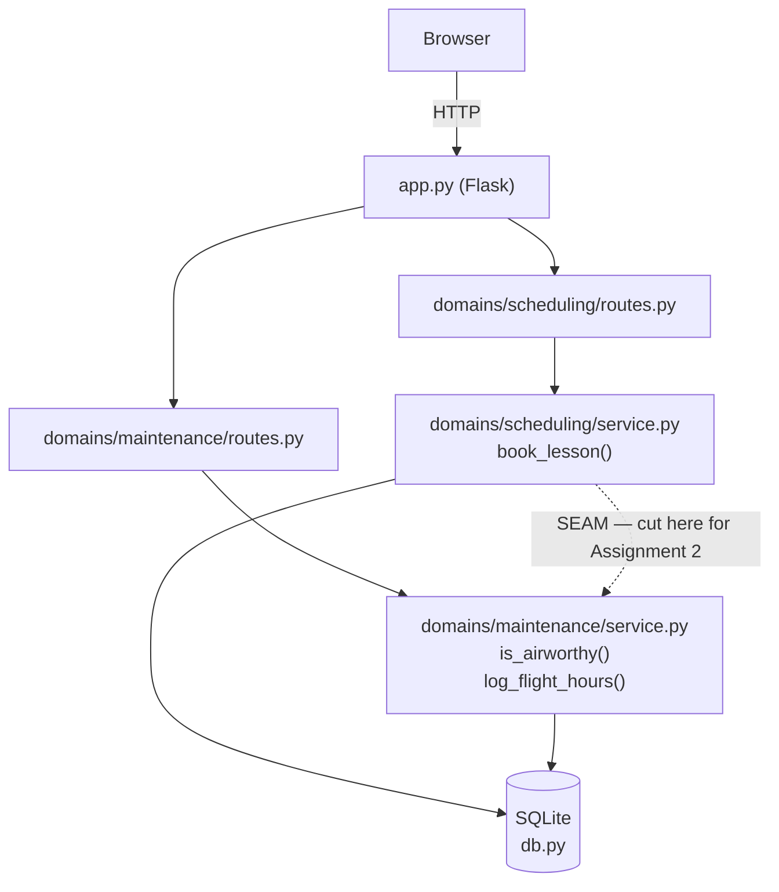
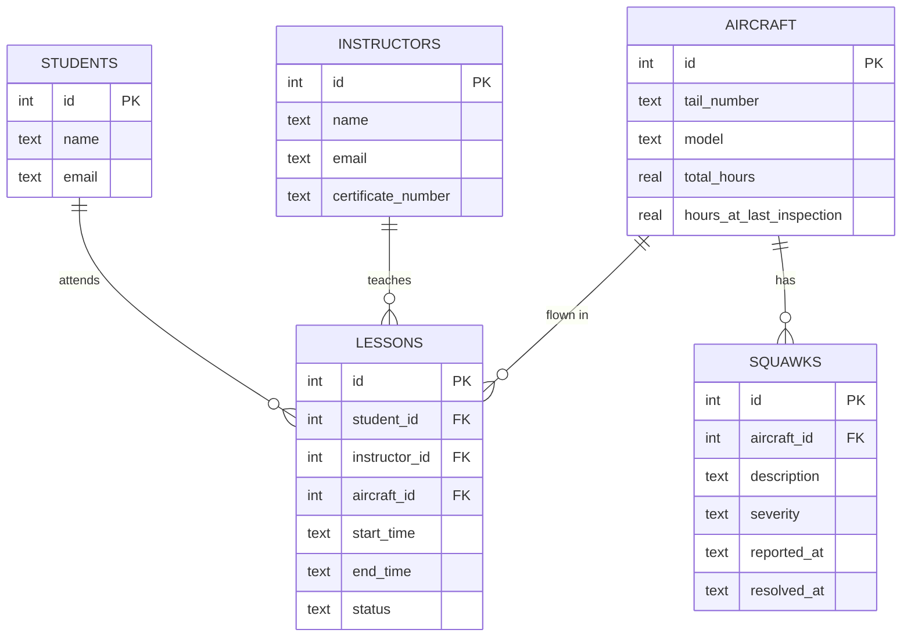

# Flight School Ops — Report

## 1. SDLC model

**Model: Iterative and Incremental Development, TDD-driven.** There was no
upfront full design-then-build phase (that would be Waterfall) and no formal
ceremonies like sprints or standups (that would overclaim Scrum, for a
one-person project). Instead, each iteration shipped one small vertical
slice: one business rule, test-first, committed on its own, before moving to
the next.

**Working SMART goal:** *Ship both required feature domains (scheduling and
maintenance) with ≥70% tested coverage on their business logic and a working
Flask UI reachable over HTTP, by 2026-10-12.* Specific (two named domains),
Measurable (coverage percentage, routes either work over HTTP or they
don't), Achievable (scoped tightly to the two domains the assignment
requires, nothing extra), Relevant (directly the assignment's own grading
categories), Time-bound (the actual deadline).

**How it played out in practice — iteration order:**
1. Walking skeleton: Flask app that boots, binds correctly, creates the
   SQLite schema. Nothing else.
2. Maintenance domain business logic (`is_airworthy`, `log_flight_hours`),
   test-first, no route yet.
3. Scheduling domain business logic (`book_lesson`, conflict detection),
   test-first, calling into maintenance through one function.
4. Routes and templates for both domains, verified by hand over real HTTP
   (deliberately not unit-tested — see `ADR.md` entry 4).
5. Process documentation (`ADR.md`, `AI_USAGE.md`) written alongside the
   code that produced each decision, not after the fact.

**Where practice deviated from the plan, honestly:** the `README.md`
coverage claim went stale for one iteration — once routes existed, running
the same `pytest --cov=domains` command silently started counting untested
route files, dropping the reported number from 100% to 30% without any
regression in the actual tested logic. That's a real failure of "keep docs
in sync with code" inside an otherwise iterative process, caught and fixed
in a dedicated commit once noticed rather than left for the report to paper
over.

## 2. Architecture overview

Single process, single container, as required. One Flask app, two
blueprints, each blueprint's routes calling into its own domain's
`service.py`, both ultimately reading/writing the same SQLite file.



The dashed arrow from `SchedService` to `MaintService` is deliberately the
**only** line crossing the domain boundary (`ADR.md` entry 2), and it's
where Assignment 2 would cut this into two services: scheduling asks
maintenance "is this aircraft airworthy?" through `is_airworthy(conn,
aircraft_id)`, and tells it "this many hours were just flown" through
`log_flight_hours(conn, aircraft_id, hours)` — never reading or writing the
`aircraft`/`squawks` tables itself. That function pair becomes the one
HTTP call (or message) between two services; everything else in each
domain stays exactly as it is.

## 3. Database schema



Every relationship is a foreign key, not duplicated data (`ADR.md` entry 3).
`squawks.severity` is constrained to `'minor'` or `'safety'` by a `CHECK`
constraint in `db.py`; an aircraft is grounded if it has any unresolved
`'safety'` squawk, or if `total_hours - hours_at_last_inspection >= 100`
(the real FAA 100-hour inspection rule for aircraft used for instruction).

## 4. Setup, testing, and container evidence

The full instructions below are reproduced from `README.md`.

### Running it directly

```
python3 -m venv venv
source venv/bin/activate
pip install -r requirements.txt
python app.py
```

### Running it with Docker

```
docker build -t flight-school-ops .
docker run -p 8000:8000 -v flight-school-data:/data flight-school-ops
```

### Environment variables

| Variable | Default | Purpose |
|---|---|---|
| `PORT` | `8000` | Port the app listens on. |
| `DATA_DIR` | `./data` locally, `/data` in the container | Directory holding the SQLite file (`flight_school.db`). |
| `SECRET_KEY` | `dev-secret-key` | Flask session/flash-message signing key. |

No seed data: every table (students, instructors, aircraft, lessons,
squawks) is populated through the app's own forms, not reference data that
needs loading on first boot — so there's nothing to ship as a `seed.sql`
and no first-boot loading logic to make idempotent.

### Tests and coverage

```
pytest --cov=domains.maintenance.service --cov=domains.scheduling.service --cov-report=term-missing
```

20 tests, 100% coverage on the two domains' business logic
(`domains/*/service.py`). Routes (`domains/*/routes.py`) are intentionally
excluded from the coverage target: they're Flask glue (read a form, call
the service, redirect), which is what the assignment's testing section
says not to chase coverage on. They were verified by hand, by running the
app and exercising every route over real HTTP.

### §7 container-run evidence

```
=== SDD Assignment 1 contract check ===
Repository: /Users/hadimoumeni/Downloads/sdd-flight-school-tracker

==> Repository shape
  PASS  one Dockerfile, one manifest (requirements.txt)

==> Build from a clean context, no build args
  PASS  image built
  PASS  image size 53 MB

==> Start on PORT=8000 and reach it from the host
  PASS  HTTP 302 from http://localhost:8000/

==> SQLite file under DATA_DIR
  PASS  found in /data: flight_school.db

==> Data persists, and a second boot does not re-seed
  PASS  volume at /data persists
  PASS  row counts unchanged across restart: aircraft=0 instructors=0 lessons=0 squawks=0 students=0

==> PORT override is honoured (not hardcoded)
  PASS  HTTP 302 from http://localhost:9123/

=== ALL CHECKS PASSED ===
```

## 5. AI-disclosure statement

I acknowledge the use of Claude Code (Anthropic) to design, implement, test,
and document this project. The prompts used include: scaffolding the Flask
app skeleton to the local container contract in §7; test-driving the
maintenance domain's airworthiness rules and the scheduling domain's
booking/conflict logic; wiring both domains to Flask routes and Jinja2
templates; fixing a stale coverage claim once routes existed; test-driving
a missed edge case (booking with `end_time` before `start_time`); adding
email validation on student/instructor creation; test-driving
`complete_lesson`, which logs flight hours against an aircraft and was the
missing link between a booked lesson and the 100-hour inspection rule ever
actually triggering; and drafting the `ADR.md` and `AI_USAGE.md` entries
documenting each of the decisions above as they were made. The output of
these prompts was used to
write the production code, tests, and process documentation in this
repository, verified by running the test suite and by exercising every
route over real HTTP before each commit. The detailed, per-commit log of
these interactions — including what was accepted, modified, and why — lives
in `AI_USAGE.md`.
