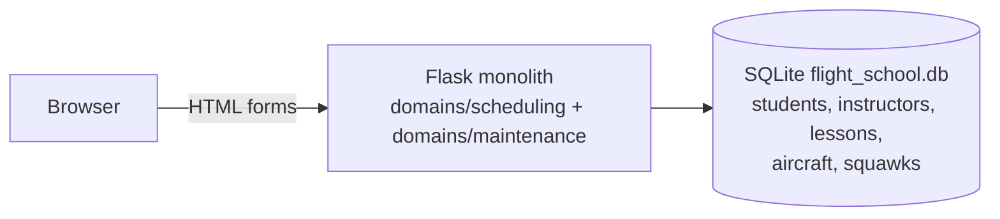
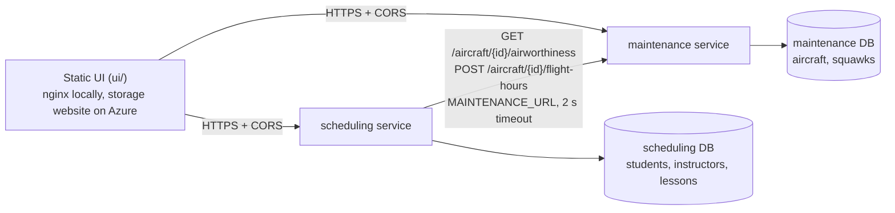
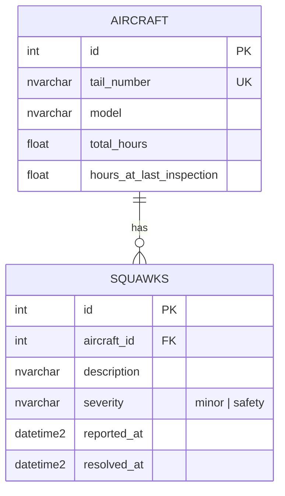
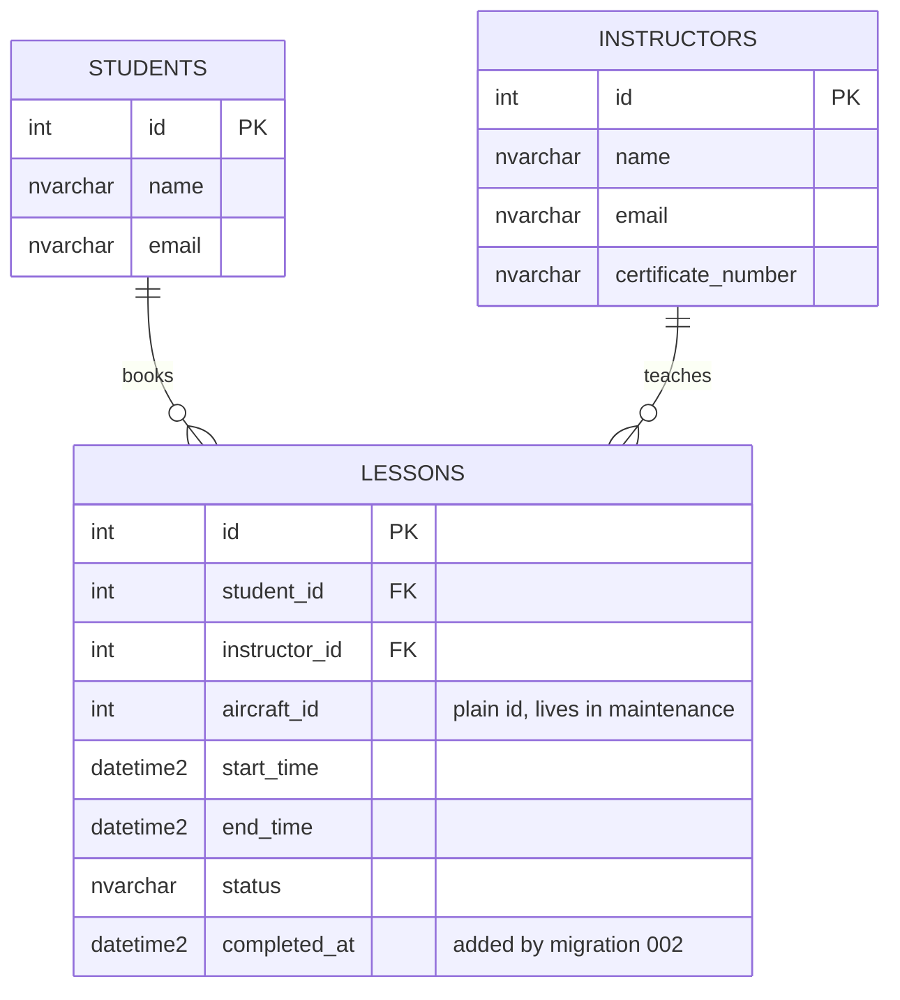
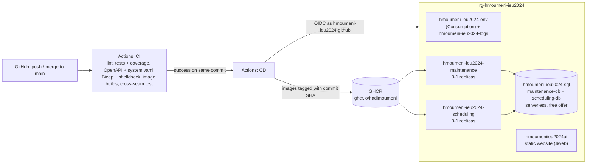
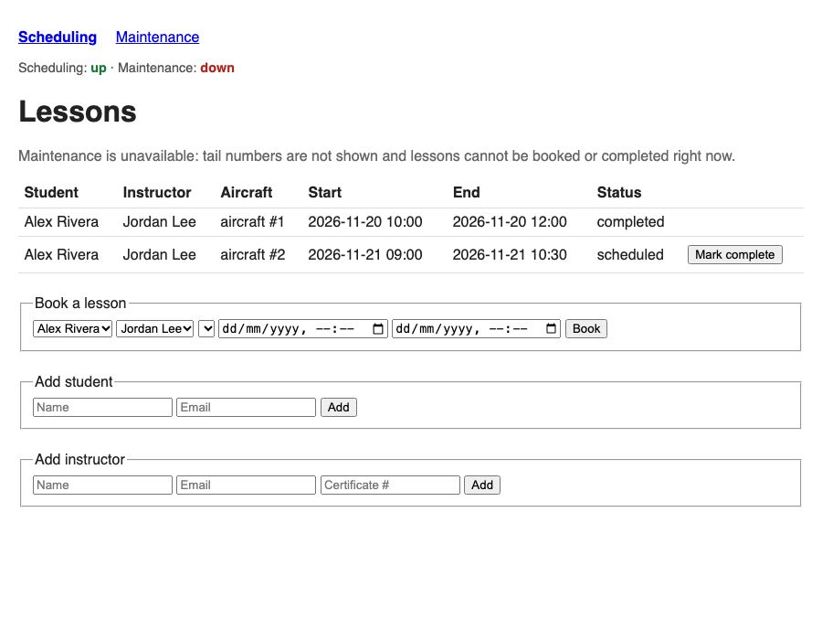
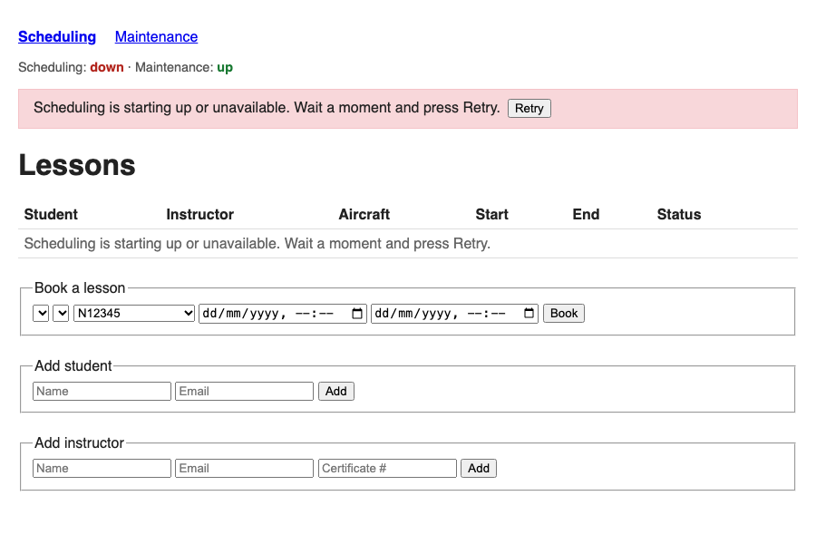

# Flight School Ops: Split, Ship and Operate (Individual Assignment 2)

**Student:** Hadi Moumeni (hmoumeni.ieu2024) · **Repository:** https://github.com/hadimoumeni/sdd-flight-school-tracker<br>
**Live URL:** not available, because my Azure for Students subscription is disabled (section 4).

## 1. What changed

The Assignment 1 monolith (one Flask process, one SQLite file, server-rendered pages) is now two Flask services split along the seam from ADR-2, each with its own SQL Server database, Dockerfile and versioned migrations. A static UI calls both services from the browser. `docker compose up --build` starts the whole system from a clean clone. CI tests every push, and the CD workflow and Bicep deploy every merge to `main`, once a subscription exists. The decisions are in ADR-6 to ADR-10.

## 2. Architecture: before and after

**Before (Assignment 1).** Scheduling reached maintenance through one function call, `is_airworthy(conn, aircraft_id)`. That function was the seam.



**After (Assignment 2).** Each service owns its tables. The cut foreign key `lessons.aircraft_id` is now a plain ID, checked over HTTP at booking time.



Two flows cross the seam on the server: booking (an airworthiness check) and completing a lesson (logging hours). The UI joins tail numbers onto lessons in the browser. If maintenance does not answer within 2 s, scheduling returns 503 with a clear message and keeps serving everything else (ADR-6).

## 3. Database per service (matches the migrations)





Both databases also hold `schema_migrations` (which files were applied) and `health_check` (one row that `/health` writes, to prove the service can write).

## 4. Deployment



CD signs in through OpenID Connect, so no Azure password exists. It deploys `infra/main.bicep` with the SHA-tagged images, writes `ui/config.js` with the service URLs, uploads `ui/` to `$web`, and fails if `/health` does not return 200 within 6 minutes. The one-time setup (identity, contained database users, secrets, Reader for the professors) is in `infra/setup.sh` and listed step by step in the README.

**Status: not deployed.** When I started the Azure setup on 21 November, `az account list` showed my Azure for Students subscription as *Disabled*, and the portal answers "We can't reactivate your subscription. Please contact Azure Support." The only enabled subscription on my account is "IE Workspaces", the university's, which the brief does not allow me to use. So there is no live URL, no successful CD run on Azure, and no migration evidence on Azure. CD is written so it is skipped, not failed, until setup has run ([skipped CD run](https://github.com/hadimoumeni/sdd-flight-school-tracker/actions/runs/44947876974)). Everything that can be checked without a subscription is checked in CI: the Bicep compiles, `shellcheck` passes on the setup script, and the workflows parse.

## 5. Migration evidence

Migrations are numbered SQL files applied once each on startup, recorded in `schema_migrations`, one transaction per file (ADR-7). `002_add_lessons_completed_at.sql` changes a table that already holds data: it adds `completed_at` as NULL and backfills completed lessons with their end time. Because Azure was not available, the evidence is from the same procedure run locally on one persistent SQL Server volume: data created on the old version, then the new image started.

```
=== BEFORE migration 002
version: 001_init.sql
id | aircraft_id | start_time       | end_time         | status
1  | 1           | 2026-11-20 10:00 | 2026-11-20 12:00 | completed
2  | 1           | 2026-11-21 09:00 | 2026-11-21 10:30 | scheduled

=== Startup log of the new scheduling container
scheduling-1  | applied migration 002_add_lessons_completed_at.sql

=== AFTER migration 002
version: 001_init.sql, 002_add_lessons_completed_at.sql
id | status    | completed_at
1  | completed | 2026-11-20 12:00   (backfilled)
2  | scheduled | NULL
```

Two restarts afterwards applied nothing (full output: `docs/evidence/migration-002-local.txt`). The CI integration test also checks `completed_at` after completing a lesson.

## 6. Partial-failure evidence

With `docker compose stop maintenance`, scheduling keeps serving its own data. Tail numbers show as "aircraft #N", a notice explains that booking and completing are paused, and booking returns 503 *"maintenance service is unavailable, so the aircraft cannot be checked. Try again later."* in about 30 ms (the CI test asserts under 5 s). With scheduling stopped, its page shows "Scheduling is starting up or unavailable" with a Retry button. The same message covers a cold start on Azure. Every browser call gives up after 15 s.

 

## 7. Pipeline evidence

- Successful CI on `main` (all jobs, including the cross-seam test on the compose stack): [run 44947792339](https://github.com/hadimoumeni/sdd-flight-school-tracker/actions/runs/44947792339).
- Successful CD run on `main`: none, because there is no subscription to deploy to (section 4).
- Failed run that was fixed: none so far. All CI runs in the repository have passed; changes were checked locally before pushing. The one real mistake was an unquoted comma that broke an OpenAPI description, and the validator caught it locally before the push.

## 8. Testing and observability

Unit tests cover the business rules and the HTTP client, with coverage at least 70% enforced per service (both at 100%). Six integration tests run against the real compose stack in CI, including a contract test against maintenance's OpenAPI document and the partial-failure test (ADR-9). `GET /health` returns `{"status","db","version"}`, with 200 only if the service can write its own database, and never depends on the other service. Each request logs `method path status duration` to stdout.

## 9. AI disclosure

I used Claude Code (Anthropic) throughout this assignment: to write code, the Dockerfiles, compose, the workflows, Bicep, the setup script, tests and documentation, which I then read, ran and checked. Every significant use is logged in `AI_USAGE.md`, with what I changed and an explanation in my own words of how each piece works, infrastructure files included. The decisions in ADR-6 to ADR-10 are mine, and I can explain every file in the repository.
